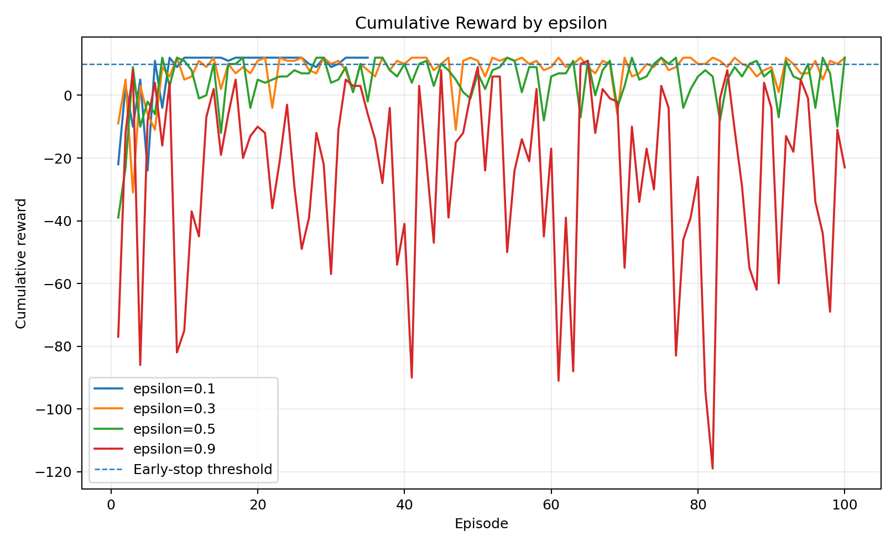
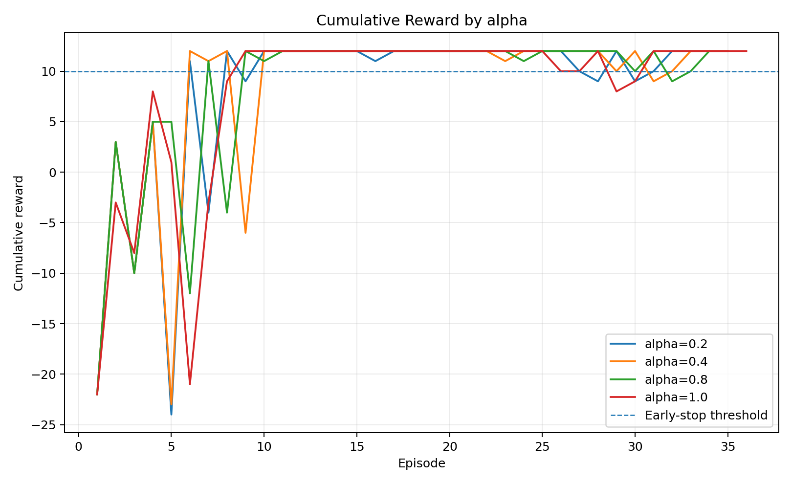
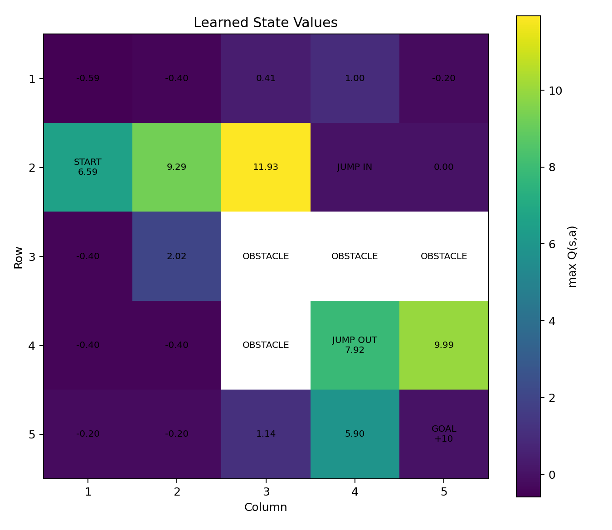
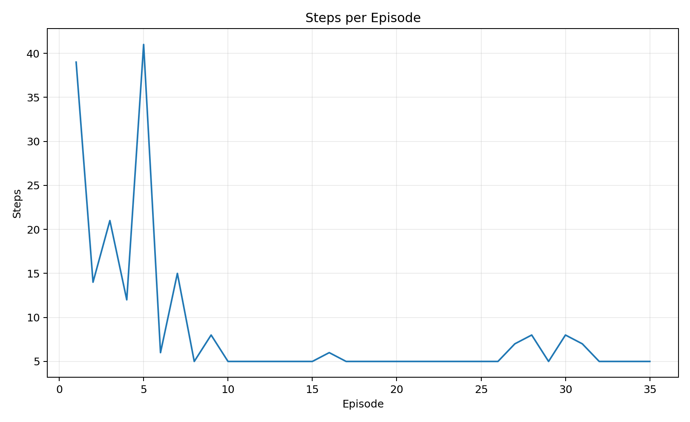
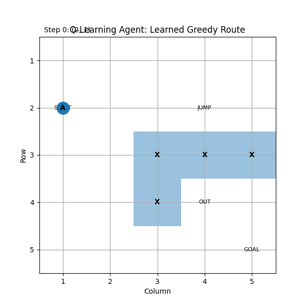

# Reinforcement Learning Pathfinding with Q-Learning

A reproducible Python implementation of a tabular **Q-learning** agent that learns to navigate a bounded 5×5 Grid World using rewards, exploration and Temporal Difference learning.

This repository is a clean reconstruction of a reinforcement-learning project developed during MSc study. It is designed as a portfolio-ready GitHub project: the environment, agent, experiments, generated data and visualisations are all included.

## Project idea

The agent begins at `(2, 1)` with no knowledge of the environment. It must learn a useful route to the goal at `(5, 5)` while dealing with:

- non-traversable obstacles;
- a `-1` step penalty for normal or invalid moves;
- a special jump state at `(2, 4)` that teleports the agent to `(4, 4)` and gives `+5` reward;
- a terminal goal reward of `+10`.

The goal is not to hard-code a path. The agent learns state-action values from experience.

## What this project demonstrates

- Reinforcement Learning fundamentals
- Markov Decision Processes
- Off-policy Q-learning
- Temporal Difference learning
- Bellman optimality updates
- Epsilon-greedy exploration
- Exploration vs exploitation
- Hyperparameter experimentation
- Early stopping using a moving reward average
- Q-table and state-value visualisation
- Object-oriented Python design
- Reproducible experiment logging

## Grid World

Coordinates are represented as `(row, column)` and are 1-indexed.

```text
Row 1   .       .       .       .       .
Row 2   START   .       .       JUMP    .
Row 3   .       .       X       X       X
Row 4   .       .       X       OUT     .
Row 5   .       .       .       .       GOAL
         C1      C2      C3      C4      C5
```

`X` represents an obstacle. Entering `JUMP` moves the agent automatically to `OUT`.

## Q-learning update

The implementation uses the standard update rule:

```text
Q(s,a) <- Q(s,a) + alpha * [r + gamma * max Q(s',a') - Q(s,a)]
```

where:

- `Q(s,a)` is the current estimate for taking action `a` in state `s`;
- `alpha` is the learning rate;
- `r` is the immediate reward;
- `gamma` is the discount factor;
- `max Q(s',a')` is the best estimated future value in the next state.

The behaviour policy is epsilon-greedy: with probability `epsilon` the agent explores a random action, otherwise it chooses the action with the highest current Q-value.

## Experiments

The project includes two groups of experiments.

### Exploration-rate experiment

The following epsilon values are compared:

```text
0.1, 0.3, 0.5, 0.9
```

This demonstrates how too much random exploration can reduce the stability of a learned policy.

### Learning-rate experiment

The following alpha values are compared:

```text
0.2, 0.4, 0.8, 1.0
```

This demonstrates how strongly new experience is allowed to change previously learned Q-values.

### Training configuration

- Discount factor: `gamma = 0.9`
- Maximum episodes: `100`
- Moving-average window: `30 episodes`
- Early-stop condition: 30-episode average reward `> 10`
- Reproducibility seed: `42`

## Included reproducible run

The generated files currently included in this repository were produced with seed `42`. In this reconstruction, the epsilon experiment produced:

| Epsilon | Episodes run | Converged? | Final 30-episode average |
|---:|---:|:---:|---:|
| 0.1 | 35 | Yes | 10.97 |
| 0.3 | 100 | No | 9.23 |
| 0.5 | 100 | No | 5.80 |
| 0.9 | 100 | No | -30.57 |

The learning-rate experiment produced:

| Alpha | Episodes run | Converged? | Final 30-episode average |
|---:|---:|:---:|---:|
| 0.2 | 35 | Yes | 10.97 |
| 0.4 | 35 | Yes | 11.10 |
| 0.8 | 34 | Yes | 10.10 |
| 1.0 | 36 | Yes | 11.03 |

These numbers describe the code in this repository, not a manually copied table from the earlier coursework document.

## No external dataset is required

This is a reinforcement-learning project, so the agent does not train from a conventional labelled CSV dataset. It creates experience by interacting with the environment.

For reproducibility, the repository exports that experience and the learned values as CSV files. The `data/` directory contains:

- the environment layout;
- episode-by-episode training logs;
- epsilon experiment results;
- learning-rate experiment results;
- the final learned Q-values.

These files can be regenerated at any time by running `train.py`.

## Repository structure

```text
q_learning_gridworld_repo/
├── data/
│   ├── README.md
│   ├── environment_layout.csv
│   ├── epsilon_experiment_summary.csv
│   ├── learning_rate_experiment_summary.csv
│   ├── final_agent_training_log.csv
│   ├── final_q_values.csv
│   └── training_log_*.csv
├── docs/
│   └── project_summary.md
├── results/
│   ├── epsilon_comparison.png
│   ├── learning_rate_comparison.png
│   ├── learned_state_values.png
│   └── steps_per_episode.png
├── src/
│   ├── __init__.py
│   ├── experiments.py
│   ├── grid_environment.py
│   ├── q_learning_agent.py
│   └── visualization.py
├── tests/
│   └── test_environment.py
├── .gitignore
├── LICENSE
├── README.md
├── requirements.txt
├── run_demo.py
└── train.py
```

## Installation

Clone the repository and create a virtual environment:

```bash
git clone https://github.com/YOUR-USERNAME/q-learning-gridworld-pathfinding.git
cd q-learning-gridworld-pathfinding
python -m venv .venv
```

Activate it on Windows:

```bash
.venv\Scripts\activate
```

On macOS/Linux:

```bash
source .venv/bin/activate
```

Install dependencies:

```bash
pip install -r requirements.txt
```

## Run the full experiment

```bash
python train.py
```

This trains the agents, runs the hyperparameter experiments, exports CSV data and creates all figures in `results/`.

## Run the learned-policy demo

```bash
python run_demo.py
```

The demo trains the final agent and prints the greedy route learned from the start state to the goal.

## Run tests

```bash
pytest
```

## Generated visualisations

### Epsilon comparison



### Learning-rate comparison



### Learned state values



### Steps per episode




## Demo animation

The repository also includes an animation of the greedy route learned by the trained agent:



A short MP4 version is available at `media/agent_path_demo.mp4`, which can be used as a LinkedIn project video. Recreate the GIF with:

```bash
python make_animation.py
```

## Possible extensions

- Compare Q-learning against SARSA using the same environment.
- Replace fixed epsilon with epsilon decay.
- Run experiments across many random seeds and report confidence intervals.
- Expand the environment to larger or stochastic grids.
- Replace the tabular Q-table with a Deep Q-Network (DQN).
- Add an animated visualisation of the learned route.

## References

The project is based on standard reinforcement-learning concepts including:

- R. S. Sutton and A. G. Barto, *Reinforcement Learning: An Introduction*, 2nd ed., MIT Press, 2018.
- C. J. C. H. Watkins and P. Dayan, “Q-learning,” *Machine Learning*, vol. 8, pp. 279–292, 1992.

## Author

**Minhajul Abedin**

MSc Computer Science and Technology — Ulster University, London.

## Licence

Released under the MIT License. See `LICENSE`.

---

### Reproducibility note

The implementation in this repository was reconstructed from the project specification and report rather than copied from the original coursework source files. The included figures and CSV files are generated by this code. Because reinforcement-learning outcomes depend on randomness and implementation details, exact numerical values can differ from results shown in an earlier report if that earlier run used a different random state or action-selection detail.
